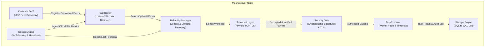

# MeshWeaver: Zero-Dependency P2P Async Task Broker

[](https://www.python.org/downloads/)
[](https://opensource.org/licenses/MIT)
[](https://github.com/psf/black)
[]()

MeshWeaver is a pure-Python, zero-dependency peer-to-peer task broker for distributed and edge computing environments. It eliminates centralized message brokers (such as Celery, Redis, or RabbitMQ) by forming an autonomous, self-organizing mesh network where compute workloads are negotiated, cryptographically verified, load-balanced, and executed across peers with zero single points of failure.

---

## Key Features

* **Zero Central Infrastructure**: No Redis, RabbitMQ, or central coordinator required. Peers dynamically discover one another and coordinate directly.
* **Kademlia DHT Peer Discovery**: 160-bit keyspace with XOR distance routing ($k=20$, $\alpha=3$) for scalable $O(\log N)$ peer lookups without hardcoded IP lists.
* **Gossip Telemetry & Load Balancing**: Nodes exchange real-time CPU and RAM utilization metrics every 5 seconds. Compute tasks are automatically dispatched to the peer with the lowest load.
* **Automated Fault Tolerance & Heartbeat Monitors**: Continuous heartbeat tracking flags unresponsive nodes and instantly re-routes orphaned in-flight tasks to healthy workers. Bounded retries isolate permanently failing jobs into a dead-letter queue.
* **End-to-End Transport Layer Security (TLS/SSL)**: Inter-node TCP connections are encrypted with modern TLS 1.2+ using automatically provisioned self-signed X.509 certificates.
* **Cryptographic Signatures & Verification**: Every compute request is digitally signed (HMAC-SHA256 & Ed25519 support). Workers cryptographically verify incoming requests and reject tampered or replayed tasks.
* **Rich Terminal & Web Observability**: Live terminal dashboard powered by `rich` (with ANSI fallback) and a zero-dependency browser Web UI providing real-time visibility into cluster topology, DHT routing tables, gossip resource metrics, and task lifecycle execution.
* **Edge-Ready & Pure-Python**: Runs on standard Python 3.7+ across Windows, Linux, and macOS (Raspberry Pis, minimal containers, edge servers, or local dev machines) with zero required external dependencies.

---

## Architecture Overview



---

## Repository Structure

```
MeshWeaver/
├── setup.py                            # Edge-deployment package specification
├── pyproject.toml                      # Modern Python packaging standard
├── meshweaver_cli.py                   # Unified CLI tool (status, benchmark, test, demo)
├── cli.py                              # Subcommand node launcher CLI
├── config.py                           # Global network, DHT, gossip & task settings
│
├── task/                               # Task engine, execution & security (Member 4)
│   ├── models.py                       # Task, TaskResult, TaskStatus, TaskPriority
│   ├── serializer.py                   # Checksummed serializer & math benchmarks
│   ├── security.py                     # HMAC-SHA256 task signing & verification
│   └── executor.py                     # Asynchronous pool executor with security gates
│
├── scheduler/                          # Workload routing & fault tolerance (Member 4)
│   ├── router.py                       # Load-aware worker selection (Lowest CPU, Composite)
│   └── reliability.py                  # Lease tracking, async watchdog & DLQ recovery
│
├── dht/                                # Kademlia DHT & peer discovery (Member 3)
│   ├── node_id.py                      # 160-bit NodeID and XOR distance metric
│   ├── routing.py                      # K-bucket routing table (k=20, LRU cache)
│   └── discovery.py                    # Asyncio UDP RPCs (PING, FIND_NODE), bootstrap join
│
├── gossip/                             # Gossip protocol & failure detection (Member 5)
│   ├── models.py                       # PeerNodeRecord, NodeMetrics, GossipMessage
│   ├── metrics.py                      # CPU/RAM collector
│   └── monitor.py                      # GossipMonitor: heartbeats & failure detection
│
├── storage/                            # Persistent storage (Member 5)
│   └── db.py                           # SQLite WAL engine (tasks, audit events, snapshots)
│
├── network/                            # TCP transport layer (Member 2)
│   ├── protocol.py                     # Message framing & protocol constants
│   ├── server.py                       # Async TCP server (asyncio)
│   └── client.py                       # Async TCP client with auto-reconnect
│
├── security/                           # Cryptographic security & TLS
│   ├── crypto.py                       # Ed25519 keypairs, signing, verification & replay defense
│   └── tls.py                          # Self-signed X.509 certs & SSLContext provisioning
│
├── dashboard/                          # Monitoring & control interfaces (Member 5)
│   ├── web_server.py                   # HTTP server + REST API
│   ├── cli.py                          # Terminal TUI (rich library or ANSI fallback)
│   └── static/
│       └── index.html                  # Single-page Web Dashboard
│
├── tests/                              # Comprehensive test suite (125 tests)
│   ├── test_tasks.py                   # Task models, serializer & execution tests
│   ├── test_scheduler.py               # Load-based routing tests
│   ├── test_reliability.py             # Lease tracking & recovery tests
│   ├── test_security.py                # Cryptographic signature & tamper tests
│   ├── test_dht.py                     # DHT node ID, k-buckets, UDP discovery
│   ├── test_network.py                 # TCP transport layer tests
│   ├── test_storage.py                 # SQLite persistence tests
│   ├── test_web_dashboard.py           # Web dashboard API tests
│   └── run_all_tests.py                # Master test runner
│
├── examples/                           # Runnable demonstrations
│   ├── task_execution_demo.py          # Compute benchmark demo (primes, matrix, Pi)
│   ├── task_distribution_demo.py       # Load routing & worker crash recovery demo
│   ├── web_dashboard_demo.py           # Browser UI & simulation demo
│   ├── week3_routing_demo.py           # Routing & recovery demo
│   └── week4_security_demo.py          # Security & live topology demo
│
└── docs/                               # Subsystem specifications
    ├── task_engine_architecture.md     # Architecture spec & integration contracts
    ├── dht_architecture.md             # Kademlia DHT & UDP protocol specification
    ├── week3_fault_tolerance_architecture.md # Workload routing & fault recovery specification
    └── week4_security_dashboard_architecture.md # TLS encryption & cryptography specification
```

---

## Installation & Edge Deployment

MeshWeaver is built with **zero required external dependencies** and runs natively on lightweight edge devices like Raspberry Pis, minimal Linux containers, and local developer machines.

Install directly as an editable package:
```bash
pip install -e .
```

Optional enhanced extras (for rich terminal rendering and advanced pickling):
```bash
pip install -e .[enhanced]
```

---

## Command-Line Interface (CLI)

MeshWeaver provides a unified command-line tool `meshweaver` (or `python meshweaver_cli.py`):

```bash
# Check local node telemetry and engine status
meshweaver status

# Run standard mathematical benchmarks (Monte Carlo Pi, Prime Sieve, Matrix Multiply)
meshweaver benchmark

# Run the full automated test suite (125 tests)
meshweaver test

# Run the task distribution & crash recovery simulation
meshweaver demo
```

You can also run individual nodes and demos directly via `cli.py`:
```bash
# Start a node with TLS and signatures enabled
python cli.py start --host 127.0.0.1 --port 8000 --dht-port 8001

# Join an existing cluster via bootstrap seed
python cli.py start --port 8002 --dht-port 8003 --bootstrap 127.0.0.1:8001

# Run interactive cluster demos
python examples/task_distribution_demo.py
python examples/web_dashboard_demo.py
```

---

## Python API Usage

```python
import asyncio
from task.models import Task, TaskPriority
from task.executor import TaskExecutor
from scheduler.router import TaskRouter, WorkerNodeInfo

def compute_square(x: int) -> int:
    return x * x

async def main():
    # 1. Initialize executor and load-aware router
    executor = TaskExecutor()
    router = TaskRouter(local_node_id="local_worker_1")

    # 2. Register mesh peer metrics
    router.register_worker(WorkerNodeInfo(node_id="node_edge_a", cpu_percent=18.5))
    router.register_worker(WorkerNodeInfo(node_id="node_edge_b", cpu_percent=72.0))

    # 3. Create a task
    task = Task.from_callable(compute_square, 12, name="square_calculation", priority=TaskPriority.HIGH)

    # 4. Route task to the peer with lowest CPU
    target_node = router.select_worker(task)
    print(f"Dispatched task {task.task_id[:8]} to optimal worker: {target_node}")

    # 5. Execute workload
    result = await executor.execute(task)
    print(f"Status: {result.status.value} | Result: {result.return_value} | Elapsed: {result.execution_time_seconds:.4f}s")

if __name__ == "__main__":
    asyncio.run(main())
```

---

## Running Automated Tests

Run the master test runner across all subsystems (125 tests):
```bash
python tests/run_all_tests.py
```

Or run individual subsystem suites:
```bash
python -m unittest tests/test_tasks.py        # Task engine & serializer
python -m unittest tests/test_scheduler.py    # Load routing & overload guards
python -m unittest tests/test_reliability.py  # Fault recovery & lease watchdog
python -m unittest tests/test_security.py     # Cryptographic signatures & tamper gates
python -m unittest tests/test_dht.py          # Kademlia DHT discovery
python -m unittest tests/test_network.py      # Async TCP transport
python -m unittest tests/test_storage.py      # SQLite WAL engine
```

---

## Dependencies & License

* **Core Dependencies**: Zero external dependencies required. Runs entirely on the Python 3.7+ standard library.
* **Optional Enhancements**: `psutil` (for CPU/RAM hardware profiling), `cloudpickle` (for arbitrary closures), `rich` (for terminal TUI).
* **License**: MIT License. Developed for Advanced Python Distributed Systems Engineering.
