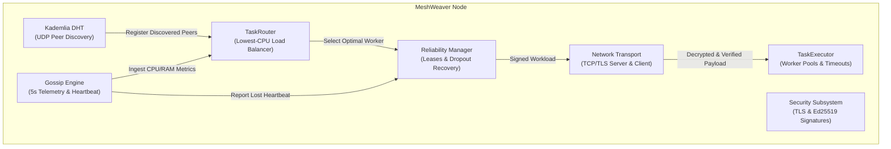

# MeshWeaver: Zero-Dependency P2P Async Task Broker

[](https://www.python.org/downloads/)
[](https://opensource.org/licenses/MIT)
[](https://github.com/psf/black)
[]()

MeshWeaver is a pure Python, decentralized peer-to-peer task broker designed for distributed and edge computing environments. It replaces centralized message brokers (like Celery, Redis, or RabbitMQ) by forming an autonomous mesh network where compute workloads are negotiated, load-balanced, and executed across peers with zero single points of failure.

---

## Key Features

* **Zero Central Infrastructure**: No Redis, RabbitMQ, or central database required. Peers dynamically discover one another and coordinate directly.
* **Kademlia DHT Peer Discovery**: 160-bit keyspace with XOR distance routing ($k=20$, $\alpha=3$) for scalable $O(\log N)$ peer lookups without hardcoded IP lists.
* **Gossip Telemetry & Load Balancing**: Nodes exchange real-time CPU and RAM utilization metrics every 5 seconds. Compute tasks are automatically dispatched to the peer with the lowest load.
* **Automated Fault Tolerance & Heartbeat Monitors**: Continuous heartbeat tracking flags unresponsive nodes and instantly re-routes orphaned in-flight tasks to healthy workers. Bounded retries isolate permanently failing jobs into a dead-letter queue.
* **End-to-End Transport Layer Security (TLS/SSL)**: Inter-node TCP connections are encrypted with modern TLS 1.2+ using automatically provisioned self-signed X.509 certificates.
* **Cryptographic Signatures (Ed25519)**: Every compute request is digitally signed by the origin node's private key. Workers cryptographically verify incoming requests and reject tampered or replayed tasks.
* **Rich Terminal UI**: Live terminal dashboard powered by `rich` providing real-time visibility into cluster topology, DHT routing tables, gossip resource metrics, and task lifecycle execution.
* **Edge-Ready & Zero-Dependency**: Runs on standard Python 3.7+ across Windows, Linux, and macOS (Raspberry Pis, servers, or local dev machines) with zero-dependency fallbacks.

---

## Architecture Overview



---

## Repository Structure

```
mesh-weaver/
├── pyproject.toml                         # Standardized Python package configuration
├── config.py                              # Global network, DHT, gossip, and security settings
├── node.py                                # Unified MeshNode orchestrator
├── cli.py                                 # Command-line interface entry point
├── meshweaver/                            # Top-level package wrapper
│   ├── __init__.py                        # Public API exports
│   └── __main__.py                        # Package executable (`python -m meshweaver`)
├── dht/                                   # Kademlia DHT & Peer Discovery
│   ├── node_id.py                         # 160-bit NodeID & XOR distance metric
│   ├── routing.py                         # K-bucket routing table (k=20, LRU cache)
│   └── discovery.py                       # Asyncio UDP RPCs (PING, FIND_NODE), bootstrap & alpha-lookup
├── task/                                  # Task Engine & Serialization
│   ├── models.py                          # Task and TaskResult lifecycle models
│   ├── serializer.py                      # Serializer with SHA-256 integrity verification
│   └── executor.py                        # Async worker pool executor
├── scheduler/                             # Workload Routing & Fault Tolerance
│   ├── router.py                          # Load-aware worker selection (lowest CPU load)
│   └── reliability.py                     # Lease tracking, worker dropout reassignment, dead-letter queue
├── gossip/                                # Gossip Protocol & Heartbeat Subsystem
│   ├── telemetry.py                       # Real-time CPU/RAM hardware profiler
│   └── engine.py                          # 5s gossip broadcast & heartbeat dropout detection
├── network/                               # Async TCP/TLS Transport
│   ├── protocol.py                        # Length-prefixed framing and JSON wire messages
│   ├── server.py                          # Async TCP/TLS TaskServer with signature verification
│   └── client.py                          # Async TCP/TLS TaskClient with task signing
├── security/                              # Cryptographic Security Subsystem
│   ├── crypto.py                          # Ed25519 keypairs, signing, verification & replay defense
│   └── tls.py                             # Self-signed X.509 certs & SSLContext provisioning
├── dashboard/                             # Real-Time Observability
│   └── cli.py                             # Live terminal UI built with Rich
├── tests/                                 # Automated Test Suite (40 Unit & Integration Tests)
│   ├── test_dht.py                        # DHT node ID, k-buckets, UDP discovery (14 tests)
│   ├── test_tasks.py                      # Task serialization & async execution (8 tests)
│   ├── test_scheduler.py                  # Load routing & dropout reassignment (4 tests)
│   ├── test_gossip.py                     # Telemetry metrics & heartbeat timeout (3 tests)
│   ├── test_security.py                   # Ed25519 signing, tampering & TLS (7 tests)
│   └── test_mesh_node.py                  # End-to-end TLS execution & routing (4 tests)
├── examples/                              # Interactive Demos & Cluster Audits
│   ├── network_audit_demo.py              # 10-node dynamic mesh discovery audit
│   ├── dht_discovery_demo.py              # DHT peer discovery walkthrough
│   ├── task_execution_demo.py             # Math & CPU compute benchmarks
│   ├── task_distribution_demo.py         # Core engine distribution demo
│   ├── week3_task_routing_and_recovery_demo.py # Load-aware routing & crash recovery demo
│   └── week4_security_and_dashboard_demo.py    # TLS sockets, Ed25519 signatures & Rich UI demo
└── docs/                                  # Architectural Specifications
    ├── dht_architecture.md                # Kademlia DHT & UDP protocol specification
    ├── task_engine_architecture.md        # Task engine & serialization architecture
    ├── week3_fault_tolerance_architecture.md # Workload routing & fault recovery specification
    └── week4_security_dashboard_architecture.md # TLS encryption & cryptography specification
```

---

## Installation

### Prerequisites
* Python 3.7 or higher

### Install Dependencies
```bash
pip install cryptography rich
```

*(Optional dependencies: `pip install cloudpickle psutil` for dynamic lambda serialization and kernel-level metrics)*

### Install MeshWeaver in Editable Mode
```bash
pip install -e .
```

---

## Quick Start & Verification

### 1. Run Automated Unit Tests (All 40 Tests)
```bash
python -m unittest discover -v tests
```

### 2. Run Interactive Demos
```bash
# Load-aware routing & worker crash recovery demo
python examples/week3_task_routing_and_recovery_demo.py

# TLS encryption, Ed25519 cryptographic signatures & Rich terminal UI demo
python examples/week4_security_and_dashboard_demo.py

# 10-Node dynamic mesh discovery audit
python examples/network_audit_demo.py
```

---

## CLI Usage

MeshWeaver provides a built-in command-line interface:

```bash
# Start a node with TLS encryption and Ed25519 signatures enabled
python cli.py start --host 127.0.0.1 --port 8000 --dht-port 8001

# Join an existing cluster via bootstrap seed
python cli.py start --port 8002 --dht-port 8003 --bootstrap 127.0.0.1:8001

# Run the Load Routing & Crash Recovery demo
python cli.py demo-week3

# Run the Security & Live Dashboard demo
python cli.py demo-week4

# Run a 10-node network connectivity audit
python cli.py audit --nodes 10
```

Or via package executable:
```bash
python -m meshweaver demo-week3
python -m meshweaver demo-week4
```

---

## Python API Usage

```python
import asyncio
from meshweaver import MeshNode

def compute_square(x: int) -> int:
    return x * x

async def main():
    # 1. Initialize and start a node
    node = MeshNode(host="127.0.0.1", port=8000, enable_tls=True)
    await node.start()

    # 2. Submit a compute task
    result = await node.submit_task(
        func=compute_square,
        args=(12,),
        name="square_calculation",
    )

    print(f"Task status: {result.status.value}")
    print(f"Return value: {result.return_value}")
    print(f"Execution time: {result.execution_time_seconds:.4f}s")

    await node.stop()

if __name__ == "__main__":
    asyncio.run(main())
```

---

## License

This project is licensed under the MIT License.
