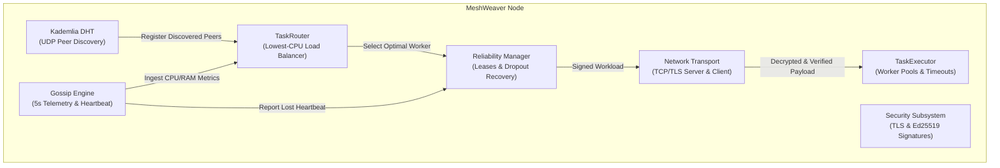

# MeshWeaver: Zero-Dependency P2P Async Task Broker

[](https://www.python.org/downloads/)
[](https://opensource.org/licenses/MIT)
[](https://github.com/psf/black)
[]()

MeshWeaver is a pure Python, decentralized peer-to-peer task broker designed for distributed and edge computing environments. It replaces centralized message brokers (like Celery, Redis, or RabbitMQ) by forming an autonomous mesh network where compute workloads are negotiated, load-balanced, and executed across peers with zero single points of failure.

---

## Key Features

* **Zero Central Infrastructure**: No Redis, RabbitMQ, or central database required. Peers dynamically discover one another and coordinate directly.
* **Kademlia DHT Peer Discovery**: 160-bit keyspace with XOR distance routing ($k=20$, $\alpha=3$) for scalable $O(\log N)$ peer lookups without hardcoded IP lists.
* **Gossip Telemetry & Load Balancing**: Nodes exchange real-time CPU and RAM utilization metrics every 5 seconds. Compute tasks are automatically dispatched to the peer with the lowest load.
* **Automated Fault Tolerance & Heartbeat Monitors**: Continuous heartbeat tracking flags unresponsive nodes and instantly re-routes orphaned in-flight tasks to healthy workers. Bounded retries isolate permanently failing jobs into a dead-letter queue.
* **End-to-End Transport Layer Security (TLS/SSL)**: Inter-node TCP connections are encrypted with modern TLS 1.2+ using automatically provisioned self-signed X.509 certificates.
* **Cryptographic Signatures (Ed25519)**: Every compute request is digitally signed by the origin node's private key. Workers cryptographically verify incoming requests and reject tampered or replayed tasks.
* **Rich Terminal UI**: Live terminal dashboard powered by `rich` providing real-time visibility into cluster topology, DHT routing tables, gossip resource metrics, and task lifecycle execution.
* **Edge-Ready & Zero-Dependency**: Runs on standard Python 3.7+ across Windows, Linux, and macOS (Raspberry Pis, servers, or local dev machines) with zero-dependency fallbacks.

---

## Architecture Overview



---

## Repository Structure

```
mesh-weaver/
├── pyproject.toml                         # Standardized Python package configuration
├── config.py                              # Global network, DHT, gossip, and security settings
├── node.py                                # Unified MeshNode orchestrator
├── cli.py                                 # Command-line interface entry point
├── meshweaver/                            # Top-level package wrapper
│   ├── __init__.py                        # Public API exports
│   └── __main__.py                        # Package executable (`python -m meshweaver`)
├── dht/                                   # Kademlia DHT & Peer Discovery
│   ├── node_id.py                         # 160-bit NodeID & XOR distance metric
│   ├── routing.py                         # K-bucket routing table (k=20, LRU cache)
│   └── discovery.py                       # Asyncio UDP RPCs (PING, FIND_NODE), bootstrap & alpha-lookup
├── task/                                  # Task Engine & Serialization
│   ├── models.py                          # Task and TaskResult lifecycle models
│   ├── serializer.py                      # Serializer with SHA-256 integrity verification
│   └── executor.py                        # Async worker pool executor
├── scheduler/                             # Workload Routing & Fault Tolerance
│   ├── router.py                          # Load-aware worker selection (lowest CPU load)
│   └── reliability.py                     # Lease tracking, worker dropout reassignment, dead-letter queue
├── gossip/                                # Gossip Protocol & Heartbeat Subsystem
│   ├── telemetry.py                       # Real-time CPU/RAM hardware profiler
│   └── engine.py                          # 5s gossip broadcast & heartbeat dropout detection
├── network/                               # Async TCP/TLS Transport
│   ├── protocol.py                        # Length-prefixed framing and JSON wire messages
│   ├── server.py                          # Async TCP/TLS TaskServer with signature verification
│   └── client.py                          # Async TCP/TLS TaskClient with task signing
├── security/                              # Cryptographic Security Subsystem
│   ├── crypto.py                          # Ed25519 keypairs, signing, verification & replay defense
│   └── tls.py                             # Self-signed X.509 certs & SSLContext provisioning
├── dashboard/                             # Real-Time Observability
│   └── cli.py                             # Live terminal UI built with Rich
├── tests/                                 # Automated Test Suite (40 Unit & Integration Tests)
│   ├── test_dht.py                        # DHT node ID, k-buckets, UDP discovery (14 tests)
│   ├── test_tasks.py                      # Task serialization & async execution (8 tests)
│   ├── test_scheduler.py                  # Load routing & dropout reassignment (4 tests)
│   ├── test_gossip.py                     # Telemetry metrics & heartbeat timeout (3 tests)
│   ├── test_security.py                   # Ed25519 signing, tampering & TLS (7 tests)
│   └── test_mesh_node.py                  # End-to-end TLS execution & routing (4 tests)
├── examples/                              # Interactive Demos & Cluster Audits
│   ├── network_audit_demo.py              # 10-node dynamic mesh discovery audit
│   ├── dht_discovery_demo.py              # DHT peer discovery walkthrough
│   ├── task_execution_demo.py             # Math & CPU compute benchmarks
│   ├── task_distribution_demo.py         # Core engine distribution demo
│   ├── week3_task_routing_and_recovery_demo.py # Load-aware routing & crash recovery demo
│   └── week4_security_and_dashboard_demo.py    # TLS sockets, Ed25519 signatures & Rich UI demo
└── docs/                                  # Architectural Specifications
    ├── dht_architecture.md                # Kademlia DHT & UDP protocol specification
    ├── task_engine_architecture.md        # Task engine & serialization architecture
    ├── week3_fault_tolerance_architecture.md # Workload routing & fault recovery specification
    └── week4_security_dashboard_architecture.md # TLS encryption & cryptography specification
```

Run the Decentralized Distribution & Node Failure Recovery Simulation:
```bash
python examples/task_distribution_demo.py
```
=======
## Module Breakdown

### DHT & Peer Discovery

**Location:** `dht/`

Implements the [Kademlia](https://pdos.csail.mit.edu/~petar/papers/maymounkov-kademlia-lncs.pdf) distributed hash table for decentralized peer discovery — no hardcoded IP lists required.

| File | Responsibility |
|------|----------------|
| `node_id.py` | 160-bit keyspace with SHA-1 hashing, XOR distance metric $d(x,y)=x \oplus y$, bitwise prefix matching |
| `routing.py` | 160 k-buckets ($k=20$) with LRU ordering, replacement cache for full buckets, $O(\log N)$ closest-peer search |
| `discovery.py` | Asyncio UDP RPC protocol (`PING`, `PONG`, `FIND_NODE`, `FOUND_NODES`), dynamic bootstrap join, $\alpha=3$ concurrent iterative lookup |

---

## Installation
### Gossip Protocol & Failure Detection

**Location:** `gossip/`

Implements a push-based gossip heartbeat protocol. Each node periodically broadcasts its metrics to a random subset of peers (fanout=3). Missed heartbeats escalate through `HEALTHY → SUSPECT → DEAD`.

| File | Responsibility |
|------|----------------|
| `models.py` | `PeerNodeRecord`, `NodeMetrics`, `GossipMessage`, `PeerHealthState` (HEALTHY/SUSPECT/DEAD) |
| `metrics.py` | CPU/RAM/uptime collector — uses `psutil` if installed, falls back to `/proc/stat`, `getloadavg`, or `process_time` |
| `monitor.py` | `GossipMonitor`: background heartbeat loop, peer timeout tracking, pluggable callbacks (`on_peer_dropout`, `on_peer_recovered`, `on_peer_suspect`) |

**Key config (`config.py`):**
```python
HEARTBEAT_INTERVAL_SECONDS = 5.0   # Gossip broadcast interval
HEARTBEAT_TIMEOUT_SECONDS  = 15.0  # Node marked DEAD after this
GOSSIP_FANOUT              = 3     # Peers per gossip round
```

---

### Task Engine & Serialization

**Location:** `task/`

Handles task packaging, integrity verification, async execution, and result reporting.

| File | Responsibility |
|------|----------------|
| `models.py` | `Task` (id, func, args, priority, timeout), `TaskResult` (status, value, exec time), `TaskPriority` (LOW/NORMAL/HIGH/CRITICAL), `TaskStatus` |
| `serializer.py` | Pickle serializer with SHA-256 digest for payload integrity — detects tampering or corruption |
| `executor.py` | Async worker pool — executes callables with timeout enforcement, captures exceptions as `TaskResult.failure()` |

**Built-in compute benchmarks (used in Web Dashboard):**
- `PrimeCount` — Sieve of Eratosthenes
- `MonteCarloPi` — Monte Carlo π estimation
- `MatrixMultiply` — Pure-Python matrix multiplication
- `SHA256Chain` — Iterated SHA-256 hash chain
- `Fibonacci` — Iterative Fibonacci

---

### Scheduler & Fault Tolerance

**Location:** `scheduler/`

Routes tasks to the best available worker and handles worker crashes gracefully.

| File | Responsibility |
|------|----------------|
| `router.py` | `TaskRouter` — maintains `WorkerNodeInfo` registry, selects workers via `LOWEST_CPU`, `ROUND_ROBIN`, or `RANDOM` strategy |
| `reliability.py` | `ReliabilityManager` — lease-based task tracking, reassigns orphaned tasks on worker dropout, dead-letter queue for unrecoverable failures |

---

## How to Run
### Persistent Storage

**Location:** `storage/db.py`

Zero-dependency SQLite storage using Python's built-in `sqlite3` with **Write-Ahead Logging (WAL)** for concurrent read/write safety.

**Three tables:**

| Table | Content |
|-------|---------|
| `tasks` | Task records (id, name, status, priority, worker, exec time, result, error) |
| `audit_events` | Timestamped cluster event log (GOSSIP, INFO, WARN, ALERT, TASK) |
| `node_snapshots` | Time-series telemetry snapshots (cpu, ram, active_tasks, status per node) |

**Thread-safe** via per-thread SQLite connections (`threading.local`). Singleton accessor: `MeshWeaverStorage.get_instance()`.

---

### Network Layer

**Location:** `network/`

Pure asyncio TCP transport for inter-node communication.

| File | Responsibility |
|------|----------------|
| `protocol.py` | Length-prefixed message framing, message type constants, encode/decode |
| `server.py` | Async TCP server — accepts connections, dispatches to registered handlers |
| `client.py` | Async TCP client with auto-reconnect and configurable timeout |

### 1. Run Automated Unit Tests

Run all 91 unit tests across all project milestones:
```bash
python3 -m unittest discover tests
```
### Web Dashboard

**Location:** `dashboard/web_server.py` + `dashboard/static/index.html`

A fully self-contained browser dashboard served by a zero-dependency Python HTTP server (no Flask, no Django).

**REST API Endpoints:**

| Method | Endpoint | Description |
|--------|----------|-------------|
| `GET` | `/` | Serves the single-page dashboard UI |
| `GET` | `/api/status` | Cluster health summary (nodes, tasks, CPU/RAM, uptime) |
| `GET` | `/api/nodes` | Per-node telemetry (cpu, ram, status, heartbeat age) |
| `GET` | `/api/events` | Recent audit event log |
| `GET` | `/api/tasks` | Persisted task history from SQLite |
| `POST` | `/api/tasks` | Dispatch a compute task (preset, strategy, priority) |
| `POST` | `/api/simulate/crash` | Simulate a peer node going offline |
| `POST` | `/api/simulate/recover` | Restore a crashed peer to HEALTHY |
| `POST` | `/api/simulate/fluctuate` | Randomly shift peer CPU/RAM metrics |

**Dashboard Features:**
- 🕸️ Canvas mesh topology (animated node graph)
- 📊 Live cluster metrics strip (nodes, tasks, CPU, RAM, uptime)
- 🖥️ Per-node telemetry cards with health badges
- ⚡ Task dispatch panel (5 built-in compute benchmarks, 3 routing strategies)
- 📋 Persistent task history table (live-polled every 5s from SQLite)
- 🎭 Chaos simulation controls (crash, recover, fluctuate)
- 📝 Real-time event log feed

Run Week 3's dedicated test suite (Routing & Fault Tolerance):
```bash
python3 -m unittest tests/test_week3_routing_fault_tolerance.py
```

Run Week 4's dedicated test suite (TLS, Cryptographic Signatures & Topology Dashboard):
```bash
python3 -m unittest tests/test_week4_security_dashboard.py
```

Run the End-to-End Multi-Node Integration test suite:
```bash
python3 -m unittest tests/test_mesh_node_integration.py
```

Run Member 5's comprehensive test runner (Weeks 1, 2, 3, and 4):
```bash
python3 -m unittest tests/test_member5_gossip.py
```

---

### 2. Run the Demos

#### Complete Multi-Node Cluster Demo (Weeks 1, 2, 3 & 4)
Simulates a 4-node cluster with TLS and HMAC signing, exchanges telemetry, routes tasks to the lowest-CPU node, recovers from a simulated worker crash, and displays the dashboard:
```bash
python3 examples/week3_4_full_mesh_demo.py
```
### Terminal CLI Dashboard

**Location:** `dashboard/cli.py`

Full-featured terminal monitor. Uses the `rich` library when installed for a polished TUI; falls back to ANSI box-drawing characters when running in minimal environments.

```
╔══════════════════════════════════════════════════════════════╗
║       MeshWeaver P2P Task Broker — Cluster Monitor           ║
╠══════════╦═══════════╦════════════════╦════════════╦═════════╣
║ Node ID  ║  Status   ║ CPU Usage      ║ RAM Usage  ║ Hrtbt   ║
╠══════════╬═══════════╬════════════════╬════════════╬═════════╣
║ ★ local  ║ HEALTHY   ║ [████░░] 42.0% ║ [██░░] 28% ║ 0.0s    ║
║ worker_1 ║ HEALTHY   ║ [██░░░░] 24.5% ║ [████] 42% ║ 1.2s    ║
║ worker_2 ║ DEAD      ║ [░░░░░░] 0.0%  ║ [░░░░] 0%  ║ DEAD    ║
╚══════════╩═══════════╩════════════════╩════════════╩═════════╝
```

### Prerequisites
* Python 3.7 or higher

### Install Dependencies
```bash
pip install cryptography rich
```

*(Optional dependencies: `pip install cloudpickle psutil` for dynamic lambda serialization and kernel-level metrics)*

### Install MeshWeaver in Editable Mode
```bash
pip install -e .
```

---

## Quick Start & Verification
### 1. Start the Web Dashboard (Recommended)

Spins up a 5-node simulated cluster and opens the browser dashboard:

#### Week 3 Milestone Demo (Lowest-CPU Routing & Fault Tolerance)
Demonstrates load-aware routing selecting the lowest CPU peer, worker dropout detection, automatic task reassignment, and Dead-Letter Queue (DLQ) bounded retry isolation:
```bash
python3 examples/week3_routing_demo.py
```

#### Week 4 Milestone Demo (TLS Transport, HMAC Signatures & Live Dashboard)
Demonstrates X.509 certificate generation, encrypted transport handshake, HMAC-SHA256 task signing, adversary tamper rejection, replay protection, and the live mesh topology dashboard:
```bash
python3 examples/week4_security_demo.py
```
python examples/web_dashboard_demo.py
# Dashboard available at http://127.0.0.1:8080
```

### 2. Run the DHT Network Audit (10 Nodes)

Proves 10 local DHT instances dynamically discover each other with zero hardcoded peer lists:

#### Member 5 Weeks 3 & 4 Demo
Demonstrates Member 5's failure detection bridge and real-time topology dashboard:
```bash
python3 examples/member5_week3_4_demo.py
```

---

### 3. Using the MeshWeaver CLI

MeshWeaver includes a zero-dependency CLI tool (`cli.py`):

### 1. Run Automated Unit Tests (All 40 Tests)
```bash
python -m unittest discover -v tests
```

### 2. Run Interactive Demos
```bash
# Load-aware routing & worker crash recovery demo
python examples/week3_task_routing_and_recovery_demo.py

# TLS encryption, Ed25519 cryptographic signatures & Rich terminal UI demo
python examples/week4_security_and_dashboard_demo.py

# 10-Node dynamic mesh discovery audit
python examples/network_audit_demo.py
# Display help and available commands
python3 cli.py --help

# Generate self-signed TLS certificates for a node
python3 cli.py certs --node-id node_alpha

# View the real-time cluster dashboard
python3 cli.py dashboard --node-id my_node --peer worker1:8001 --peer worker2:8002

# Run any project milestone demonstration
python3 cli.py demo week3
python3 cli.py demo week4
python3 cli.py demo full
```

---

## Deliverables Matrix (Weeks 1, 2, 3 & 4)

| Week | Project Requirement | Implementation | Automated Verification |
|---|---|---|---|
| **Week 1** | Peer heartbeat ping / socket communication | `gossip/models.py` (`HEARTBEAT` message type) | `test_heartbeat_ping_wire_serialization` |
| **Week 1** | Hardware telemetry metrics sampling (CPU/RAM) | `gossip/metrics.py` (`SystemMetricsCollector`) | `test_metrics_collection_baseline` |
| **Week 1** | Task serialization with SHA-256 verification | `task/serializer.py` (`TaskSerializer`) | `test_serialize_and_deserialize_callable` |
| **Week 2** | Periodic gossip loop sharing CPU/RAM every 5s | `gossip/monitor.py` (`_gossip_loop`, 5s interval) | `test_periodic_metrics_broadcast_and_receipt` |
| **Week 2** | Anti-entropy state digest synchronization | `gossip/models.py` (`GossipDigest`, delta sync) | `test_anti_entropy_digest_and_delta` |
| **Week 2** | Two-tier failure detector (`HEALTHY` $\to$ `SUSPECT` $\to$ `DEAD`) | `gossip/monitor.py` (`check_peer_health`) | `test_transition_to_dead` |
| **Week 3** | Workload routing to node with lowest reported CPU | `scheduler/router.py` (`RoutingStrategy.LOWEST_CPU`) | `test_routing_selects_lowest_cpu_node` |
| **Week 3** | Dynamic telemetry adaptation & failure exclusion | `scheduler/router.py` (`update_worker_metrics`, `exclude`) | `test_routing_dynamic_load_update` |
| **Week 3** | Continuous heartbeat failure monitor | `gossip/monitor.py` (`check_peer_health`) | `test_worker_dropout_detection` |
| **Week 3** | Automatic task recovery & re-routing on crash | `scheduler/reliability.py` (`handle_worker_dropout`) | `test_automatic_task_rerouting_on_worker_dropout` |
| **Week 3** | Bounded retry limits & Dead-Letter Queue (DLQ) | `scheduler/reliability.py` (`record_failure_and_retry`) | `test_retry_exhaustion_moves_task_to_dead_letter_queue` |
| **Week 4** | TLS/SSL node communication wrapping | `security/tls.py` (`create_server_ssl_context`, `MemoryBIO`) | `test_in_memory_tls_handshake_and_encryption` |
| **Week 4** | X.509 self-signed certificate generation | `security/tls.py` (`generate_self_signed_cert`) | `test_x509_certificate_generation` |
| **Week 4** | Cryptographic signatures for task execution requests | `security/crypto.py` (`sign_task_request`, HMAC-SHA256) | `test_sign_and_verify_valid_task` |
| **Week 4** | Tampering detection & forged task rejection | `security/crypto.py` (`verify_task_request`) | `test_tamper_detection_on_payload` |
| **Week 4** | Anti-replay attack timestamp enforcement | `security/crypto.py` (`verify_task_request`, 60s window) | `test_replay_attack_rejection` |
| **Week 4** | Real-time mesh topology view in CLI dashboard | `dashboard/cli.py` (`RichTerminalDashboard`) | `test_dashboard_renders_mesh_topology` |
| **Week 4** | Live task execution state table (leases, retries, DLQ) | `dashboard/cli.py` (`RichTerminalDashboard`) | `test_dashboard_renders_task_execution_state` |
| **Review**| Pure Python package ready for edge deployment | `setup.py`, `cli.py`, `mesh/node.py` | `test_end_to_end_lowest_cpu_routing_and_execution` |
python network_audit_demo.py
```

---

## CLI Usage

MeshWeaver provides a built-in command-line interface:

```bash
# Start a node with TLS encryption and Ed25519 signatures enabled
python cli.py start --host 127.0.0.1 --port 8000 --dht-port 8001

# Join an existing cluster via bootstrap seed
python cli.py start --port 8002 --dht-port 8003 --bootstrap 127.0.0.1:8001

# Run the Load Routing & Crash Recovery demo
python cli.py demo-week3

# Run the Security & Live Dashboard demo
python cli.py demo-week4

# Run a 10-node network connectivity audit
python cli.py audit --nodes 10
```

Or via package executable:
```bash
python -m meshweaver demo-week3
python -m meshweaver demo-week4
```

---

## Python API Usage

```python
import asyncio
from meshweaver import MeshNode

def compute_square(x: int) -> int:
    return x * x

async def main():
    # 1. Initialize and start a node
    node = MeshNode(host="127.0.0.1", port=8000, enable_tls=True)
    await node.start()

    # 2. Submit a compute task
    result = await node.submit_task(
        func=compute_square,
        args=(12,),
        name="square_calculation",
    )

    print(f"Task status: {result.status.value}")
    print(f"Return value: {result.return_value}")
    print(f"Execution time: {result.execution_time_seconds:.4f}s")

    await node.stop()

if __name__ == "__main__":
    asyncio.run(main())
```

---

## License

This project is licensed under the MIT License.
# Gossip protocol telemetry demo
python examples/gossip_telemetry_demo.py

# Terminal live monitor (rich TUI or ANSI fallback)
python examples/gossip_dashboard_demo.py

# Compute benchmark task execution
python examples/task_execution_demo.py

# Task distribution & crash recovery
python examples/task_distribution_demo.py

# DHT discovery & routing walkthrough
python dht_discovery_demo.py
```

### 4. Run Unit Tests

```bash
# All tests
python -m unittest discover tests/

# Individual test suites
python -m unittest tests/test_dht.py         # DHT (node IDs, routing, discovery)
python -m unittest tests/test_gossip.py      # Gossip protocol
python -m unittest tests/test_health.py      # Failure detection & health states
python -m unittest tests/test_tasks.py       # Task serialization & execution
python -m unittest tests/test_scheduler.py   # Workload routing & recovery
python -m unittest tests/test_storage.py     # SQLite persistence
python -m unittest tests/test_network.py     # TCP transport layer
python -m unittest tests/test_web_dashboard.py  # Web server API
```

---

## Tests

The test suite covers all major subsystems across **11 test files**:

| Test File | Subsystem | Coverage |
|-----------|-----------|----------|
| `test_dht.py` | DHT | NodeID XOR distance, k-bucket ops, iterative lookup |
| `test_gossip.py` | Gossip | Message propagation, peer record updates |
| `test_health.py` | Failure detection | HEALTHY→SUSPECT→DEAD transitions, callbacks |
| `test_tasks.py` | Task engine | Serialization, SHA-256 integrity, execution |
| `test_scheduler.py` | Scheduler | Routing strategies, dropout reassignment |
| `test_storage.py` | Storage | Task CRUD, event logging, node snapshots |
| `test_network.py` | Network | TCP framing, client/server handshake |
| `test_web_dashboard.py` | Web API | REST endpoints, task dispatch, simulations |
| `test_member5_gossip.py` | Gossip integration | End-to-end gossip cycle |
| `test_member4_tasks.py` | Task integration | Full task lifecycle |

---

## Architecture Docs

Detailed design specifications are in `docs/`:

| Document | Contents |
|----------|----------|
| [`dht_architecture.md`](docs/dht_architecture.md) | Kademlia keyspace, RPC protocol, bucket refresh |
| [`task_engine_architecture.md`](docs/task_engine_architecture.md) | Task lifecycle, serializer, executor pool design |
| [`gossip_fault_tolerance_architecture.md`](docs/gossip_fault_tolerance_architecture.md) | Gossip rounds, heartbeat escalation, failure callbacks |
| [`member5_interface.md`](docs/member5_interface.md) | Member 5 subsystem interface contracts |

---

## Dependencies

**Zero external dependencies required.** MeshWeaver runs entirely on the Python standard library.

Optional enhancements (installed separately):
- `psutil` — more accurate CPU/RAM metrics (falls back to `/proc` or `os` APIs)
- `rich` — polished terminal TUI dashboard (falls back to ANSI box rendering)

