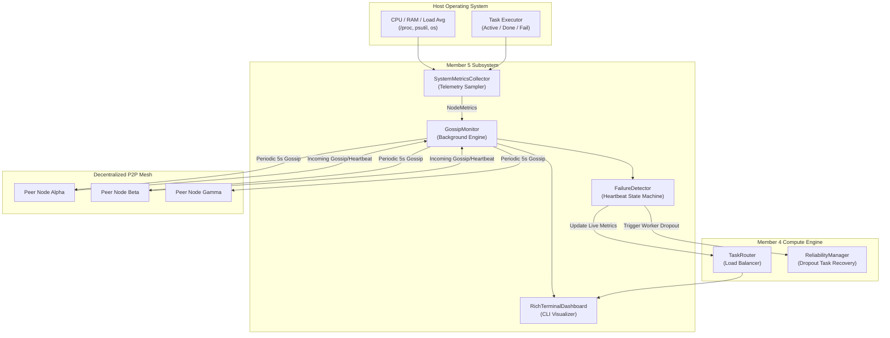
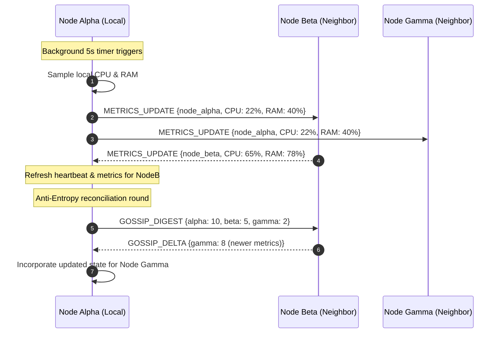
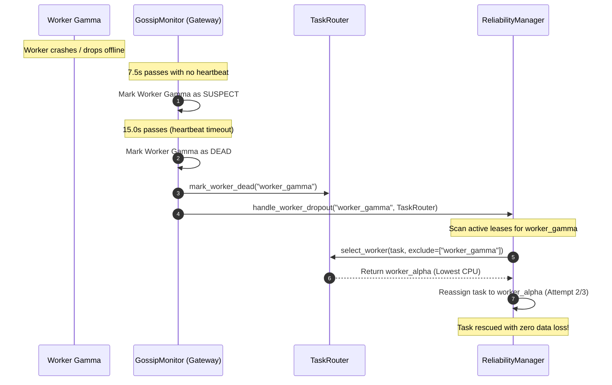

# MeshWeaver Gossip Telemetry & Fault Tolerance Architecture Specification

## 1. Architectural Overview

The **Gossip Telemetry, Failure Detection & Dashboard Subsystem** provides decentralized cluster observability and fault resilience for the MeshWeaver P2P Task Broker. It eliminates any requirement for a central monitoring authority (e.g., Consul, Prometheus, or Zookeeper) by using:
1. **Zero-Dependency System Resource Sampling** (`gossip/metrics.py`)
2. **Epidemic Telemetry Gossip Protocol** (`gossip/monitor.py`)
3. **Anti-Entropy State Digest Reconciliation** (`gossip/models.py`)
4. **Two-Tier Heartbeat Failure Detection** (`gossip/monitor.py`)
5. **Decentralized Reassignment Bridge** (with `scheduler/reliability.py`)
6. **Real-Time Rich Terminal Dashboard** (`dashboard/cli.py`)

---

## 2. Subsystem Interaction Architecture

---

## 3. Component Deep Dive

### 3.1 Telemetry Metrics Collector (`gossip/metrics.py`)
- **Zero-Dependency Guarantee**: Native support for edge devices without package managers. Automatically detects and uses `psutil` if present; falls back to pure-Python `/proc/stat`, `/proc/meminfo`, `os.getloadavg()`, and `resource.getrusage()` on POSIX/macOS/Linux.
- **Simulated Metrics Injection**: Enables deterministic multi-node simulation, failure injection, and unit testing without altering host system state.
- **Task Counters Integration**: Pulls in-flight task metrics from local compute pools to calculate task pressure.
- **Composite Load Calculation**:
  $$\text{Score} = (0.6 \times \text{CPU\%}) + (0.3 \times \min(100.0, \text{Active Tasks} \times 10)) + (0.1 \times \text{RAM\%})$$

### 3.2 Gossip Protocol Engine (`gossip/monitor.py`)
- **Cadence**: Broadcasts telemetry every 5.0 seconds (`HEARTBEAT_INTERVAL_SECONDS`), strictly satisfying the Week 2 Project Document mandate.
- **Fanout Dissemination**: Selects a randomized subset of $k=3$ neighbors per round (`GOSSIP_FANOUT`), providing $O(\log N)$ epidemic rumor convergence.
- **Anti-Entropy Digest Reconciliation**:
  - Every 2nd round, nodes exchange a compact digest vector: $\{node\_id \to (generation, sequence, timestamp)\}$.
  - Neighbors detect stale records and transmit missing delta entries (`GOSSIP_DELTA`), resolving partitions and eventual consistency.

### 3.3 Two-Tier Failure Detector (`gossip/monitor.py`)
- **`HEALTHY`**: Node has transmitted a heartbeat or metrics update within `suspect_timeout` ($15.0 / 2 = 7.5\text{s}$).
- **`SUSPECT`**: Elapsed time since last heartbeat exceeds $7.5\text{s}$. Emits warning event; tasks are not yet evicted to tolerate temporary transient packet loss.
- **`DEAD`**: Elapsed time exceeds `heartbeat_timeout` ($15.0\text{s}$). The node is flagged dead; `on_peer_dropout` is fired.
- **Automatic Recovery**: If a dead node resumes transmissions, it is promoted back to `HEALTHY` and `on_peer_recovered` is emitted.

### 3.4 Task Engine Resilience Bridge
When `on_peer_dropout(dead_node_id)` triggers:
1. `TaskRouter.mark_worker_dead(dead_node_id)` immediately removes the worker from candidate selection.
2. `ReliabilityManager.handle_worker_dropout(dead_node_id, router)`:
   - Identifies all tasks leased to `dead_node_id`.
   - Increments task retry counters (`retry_count`).
   - If within `max_retries`, reassigns the tasks to the current healthiest, lowest-load worker node.
   - If `retry_count > max_retries`, safely offloads the task to dead-letter storage.

### 3.5 Real-Time Terminal Dashboard (`dashboard/cli.py`)
- **Rich Visualization Engine**: Uses `rich` for terminal layouts, tables, and colored text when installed.
- **Zero-Dependency Terminal Engine**: Fully functional ANSI and Unicode border box renderer matching Rich formatting if running in a bare environment.
- **Telemetry Display**:
  - Visual progress bars for CPU and RAM load percentages.
  - Color-coded status badges: `[HEALTHY]` (green), `[SUSPECT]` (yellow), `[DEAD]` (red).
  - Protocol counters: Gossip rounds, messages sent/received, dropped heartbeats.
  - Event log: Circular buffer tracking cluster join, heartbeat, and failure events.

---

## 4. Sequence Diagrams

### Periodic Gossip & Telemetry Exchange

### Heartbeat Timeout & Automatic Fault Re-routing

---

## 5. Summary of Milestones Achieved

| Milestone | Project Document Requirement | Member 5 Implementation | Verification |
|---|---|---|---|
| **Week 1** | Base UDP/socket peer ping & heartbeat | `gossip.models.GossipMessage`, `HEARTBEAT` type, wire encoding | `test_heartbeat_ping_wire_serialization` |
| **Week 1** | Hardware telemetry metrics sampling | `gossip.metrics.SystemMetricsCollector` (CPU, RAM, load avg) | `test_metrics_collection_baseline` |
| **Week 2** | Background gossip task sharing CPU/RAM every 5s | `GossipMonitor._gossip_loop` with `HEARTBEAT_INTERVAL_SECONDS = 5.0` | `test_periodic_metrics_broadcast_and_receipt` |
| **Week 2** | Anti-entropy digest exchange & convergence | `GossipDigest`, `compute_anti_entropy_delta`, state merging | `test_anti_entropy_digest_and_delta` |
| **Fault Tolerance** | Heartbeat expiration & dropout detection | Two-tier failure detector (`HEALTHY` → `SUSPECT` → `DEAD`) | `test_transition_to_dead`, `test_transition_to_suspect` |
| **Fault Tolerance** | Automatic worker crash recovery & task re-routing | Native bridge to `ReliabilityManager.handle_worker_dropout` | `test_dropout_triggers_automatic_task_reassignment` |
| **Dashboard** | Rich terminal CLI dashboard | `dashboard.cli.RichTerminalDashboard` with visual meters & logs | `test_dashboard_snapshot_rendering`, `member5_demo.py` |
