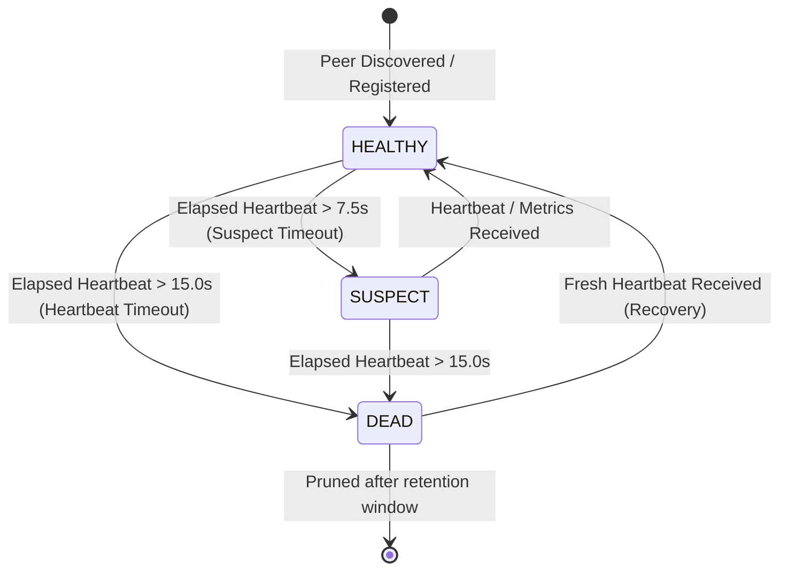

# MeshWeaver Member 5 — Gossip, Fault Tolerance & Dashboard Interface Specification

## Role Overview
- **Member**: Member 5 — Gossip, Fault Tolerance & Dashboard Developer
- **Milestones**: Weeks 1 & 2 Core Deliverables
- **Key Responsibilities**:
  1. Real-time hardware telemetry collection (CPU%, RAM%, load averages, task counters).
  2. Peer-to-peer gossip protocol engine (sharing CPU/RAM snapshots every 5 seconds).
  3. Anti-entropy state synchronization and digest reconciliation.
  4. Heartbeat health monitoring and two-tier failure detection (`HEALTHY` → `SUSPECT` → `DEAD` → `RECOVERED`).
  5. Integration with Member 4's `TaskRouter` (worker metrics) and `ReliabilityManager` (dropout task re-routing).
  6. Rich terminal dashboard (`dashboard/cli.py`) with visual meters, status badges, and alert logs.

---

## Public Interfaces & Integration Contracts

### 1. Integration with Member 1 (`node.py` & Orchestration)

To initialize and attach the gossip monitor to a node instance:

```python
from gossip.monitor import GossipMonitor
from dashboard.cli import RichTerminalDashboard

# Create the gossip monitor on the node
gossip_monitor = GossipMonitor(
    local_node_id=node_id,
    host=host,
    port=port,
    gossip_interval=5.0,        # 5-second gossip cycle (Week 2 spec)
    heartbeat_timeout=15.0,     # 15-second failure cutoff
    fanout=3,                   # 3 random peers per gossip round
)

# Start background gossip and heartbeat monitoring
await gossip_monitor.start()

# Render or launch terminal dashboard
dashboard = RichTerminalDashboard(monitor=gossip_monitor)
dashboard.print_snapshot()

# On graceful shutdown
await gossip_monitor.stop()
```

---

### 2. Integration with Member 2 (P2P Networking Layer: `network/`)

Member 5 decouples network transport using a pluggable asynchronous send callable:

```python
# transport_send_fn signature:
# async def send_network_bytes(host: str, port: int, data: bytes) -> None

gossip_monitor = GossipMonitor(
    local_node_id=my_node_id,
    transport_send_fn=network_client.send_bytes,
)

# When incoming UDP/TCP gossip packet arrives at Member 2's server:
async def on_raw_gossip_packet_received(data: bytes):
    from gossip.models import GossipMessage
    message = GossipMessage.from_bytes(data)
    response_msg = await gossip_monitor.handle_incoming_message(message)
    if response_msg:
        # Send anti-entropy delta response back to sender
        await network_client.send_bytes(sender_host, sender_port, response_msg.to_bytes())
```

---

### 3. Integration with Member 3 (DHT & Peer Discovery: `dht/`)

When Kademlia discovers new peers during bootstrap or routing table updates:

```python
# Member 3 DHT informs Gossip Monitor of discovered peer:
gossip_monitor.add_peer(
    node_id=discovered_peer_id,
    host=discovered_host,
    port=discovered_port,
)

# Member 5 Gossip Monitor provides live/dead health state back to DHT:
live_peers = gossip_monitor.get_live_peers()
dead_peers = gossip_monitor.get_dead_peers()
```

---

### 4. Integration with Member 4 (Task Engine & Scheduler: `scheduler/`)

Member 5 integrates natively with `TaskRouter` and `ReliabilityManager`:

```python
# 1. Automatic metric synchronization for load-aware routing:
gossip_monitor.sync_with_task_router(task_router)
# → Whenever gossip metrics arrive, task_router.update_worker_metrics is called automatically!

# 2. Automatic task recovery upon node crash/dropout:
gossip_monitor.sync_with_reliability_manager(reliability_manager, task_router)
# → Whenever a node drops offline (missed heartbeats > 15s),
#   reliability_manager.handle_worker_dropout(dead_node_id, task_router)
#   is invoked instantly to re-assign orphaned in-flight tasks to healthy workers!
```

---

## Wire-Protocol Message Envelopes

All gossip packets are JSON-encoded UTF-8 bytes structured as:

```json
{
  "sender_id": "node_alpha",
  "message_type": "METRICS_UPDATE",
  "sequence_number": 14,
  "timestamp": 1729780000.123,
  "payload": {
    "host": "127.0.0.1",
    "port": 8001,
    "generation": 1729779000,
    "metrics": {
      "node_id": "node_alpha",
      "cpu_percent": 18.5,
      "ram_percent": 34.2,
      "memory_used_mb": 1400.0,
      "memory_total_mb": 4096.0,
      "active_tasks": 1,
      "completed_tasks": 12,
      "failed_tasks": 0,
      "load_average_1m": 0.45,
      "uptime_seconds": 1250.0,
      "sequence_number": 14
    }
  },
  "signature": null
}
```

---

## Failure Detection Lifecycle State Machine



---

## Verification & Testing Commands

Run Member 5's dedicated test suites:
```bash
# Member 5 All-in-One Test Suite
python -m unittest tests/test_member5_gossip.py

# Dedicated Gossip & Metrics Tests
python -m unittest tests/test_gossip.py

# Dedicated Heartbeat & Fault Tolerance Tests
python -m unittest tests/test_health.py
```

Run Member 5's Demos:
```bash
# Complete Member 5 Demo (Weeks 1 & 2 Verification)
python examples/member5_demo.py

# Milestone Demo (Week 1 Ping + Week 2 5-second Gossip)
python examples/week1_2_gossip_demo.py

# Live Interactive Terminal Dashboard Demo
python examples/gossip_dashboard_demo.py
```
