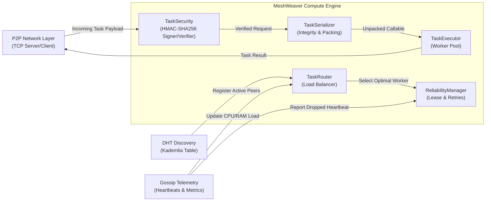

# MeshWeaver Task Execution & Workload Scheduling Subsystem

## Architectural Overview

The **Task Execution & Workload Scheduling** subsystem serves as the core compute engine of the MeshWeaver Decentralized P2P Task Broker. It provides:
1. **Decoupled Task & Result Models** (`task/models.py`)
2. **Binary Packaging & SHA-256 Verified Serialization** (`task/serializer.py`)
3. **Cryptographic Security & Tamper Verification** (`task/security.py`)
4. **Asynchronous Non-Blocking Execution Pools** (`task/executor.py`)
5. **Load-Aware Routing & Worker Selection** (`scheduler/router.py`)
6. **Fault Recovery & Bounded Retries** (`scheduler/reliability.py`)

---

## Subsystem Interaction & Contract



---

## Component Specifications

### 1. `task.models`
* `Task`: Unit of distributed computation. Tracks `task_id`, `name`, `payload`, `status`, `priority`, `retry_count`, `max_retries`, `signature`, `signer_node_id`, and lifecycle timestamps (`created_at`, `scheduled_at`, `started_at`, `completed_at`).
* `TaskResult`: Outcome record containing status, return payload, execution duration, error message, and traceback.
* `TaskStatus`: Enum representing lifecycle states (`PENDING`, `SCHEDULED`, `RUNNING`, `COMPLETED`, `FAILED`, `RETRYING`, `TIMEOUT`, `CANCELLED`).

### 2. `task.serializer`
* **Zero External Dependencies**: Automatically uses `cloudpickle` when present, falling back cleanly to standard library `pickle` and `json`.
* **Tamper-Proof Verification**: Every binary packet contains a 4-byte format header, 32-byte SHA-256 checksum, and serialized payload. Unpacking validates the checksum before attempting deserialization.
* **Pre-packaged Benchmarks**: Standardized CPU and mathematical workloads (`workload_prime_sieve`, `workload_monte_carlo_pi`, `workload_matrix_multiplication`, `workload_synthetic_delay`).

### 3. `task.security`
* **Cryptographic Signatures**: Signs task requests using HMAC-SHA256 over canonical task bytes (`task_id`, `name`, `origin_node_id`, `payload`).
* **Identity & Authentication**: Verifies that tasks originate from trusted nodes in the keyring (`TaskVerifier`).
* **Tamper Rejection**: Any modification of payload or metadata in-flight causes signature mismatch, rejecting execution with `InvalidSignatureError`.
* **Constant-Time Comparison**: Uses `hmac.compare_digest` to prevent side-channel timing attacks.

### 4. `task.executor`
* **Concurrency Isolation**: Offloads execution to `ThreadPoolExecutor` or `ProcessPoolExecutor` to prevent blocking the main asyncio event loop.
* **Security Gate**: Automatically validates task signatures via `TaskVerifier` before execution.
* **Timeout Enforcement**: Enforces `task.timeout_seconds` via `asyncio.wait_for`.
* **Telemetry Counters**: Exposes `active_task_count`, `total_completed`, `total_failed`, and `average_execution_time`.

### 5. `scheduler.router`
* **Routing Strategies**:
  * `LOWEST_CPU`: Routes task to the peer with the lowest reported CPU usage.
  * `COMPOSITE_LOAD`: Calculates a weighted score:
    $$\text{Score} = (0.6 \times \text{CPU\%}) + (0.3 \times \text{Active Task Pressure}) + (0.1 \times \text{RAM\%})$$
  * `LOCAL_FIRST`: Executes locally if local CPU is below threshold, else offloads to remote peers.
  * `ROUND_ROBIN`: Fair cyclical rotation.
* **Failure Exclusion**: Supports `exclude_node_ids` parameter so retried tasks are never routed back to a failing worker.

### 6. `scheduler.reliability`
* **Lease Management**: Tracks active assignments and detects expired leases.
* **Worker Dropout Handling**: When a node fails to send heartbeats, `handle_worker_dropout(dead_node_id, router)` instantly captures all orphaned tasks and re-routes them to healthy peers.
* **Bounded Retries & Dead-Letter Queue**: Tasks that repeatedly fail across workers are bounded by `max_retries` and moved to dead-letter storage, preventing infinite retry loops.

---

## Inter-Module Integration Cheatsheet

### Node Initialization (`node.py`)
```python
from task.executor import TaskExecutor
from task.security import TaskVerifier
from scheduler.router import TaskRouter, RoutingStrategy
from scheduler.reliability import ReliabilityManager

# Initialize security verifier
verifier = TaskVerifier(trusted_keys={"node_peer_1": b"secret1", "node_peer_2": b"secret2"})

# Initialize local compute node
executor = TaskExecutor(node_id=my_node_id, verifier=verifier)
router = TaskRouter(local_node_id=my_node_id, default_strategy=RoutingStrategy.LOWEST_CPU)
reliability = ReliabilityManager(default_max_retries=3)
```

### Network Dispatch (`network/server.py`)
```python
# When receiving a remote task execution request:
result = await executor.execute(task)
await send_network_message(target=task.origin_node_id, payload=result.to_dict())
```

### Gossip Telemetry Sync (`gossip/monitor.py`)
```python
# When incoming gossip ping arrives:
router.update_worker_metrics(
    node_id=remote_id,
    cpu_percent=remote_cpu,
    ram_percent=remote_ram,
    active_tasks=remote_active_tasks
)

# When a peer is confirmed dead (lost heartbeat):
reassigned = reliability.handle_worker_dropout(dead_node_id, router)
```

---

## Running Verification

Execute unit tests:
```bash
py -m unittest tests/test_tasks.py
py -m unittest tests/test_scheduler.py
py -m unittest tests/test_reliability.py
py -m unittest tests/test_security.py
```

Execute end-to-end engine simulation:
```bash
py examples/task_distribution_demo.py
```
