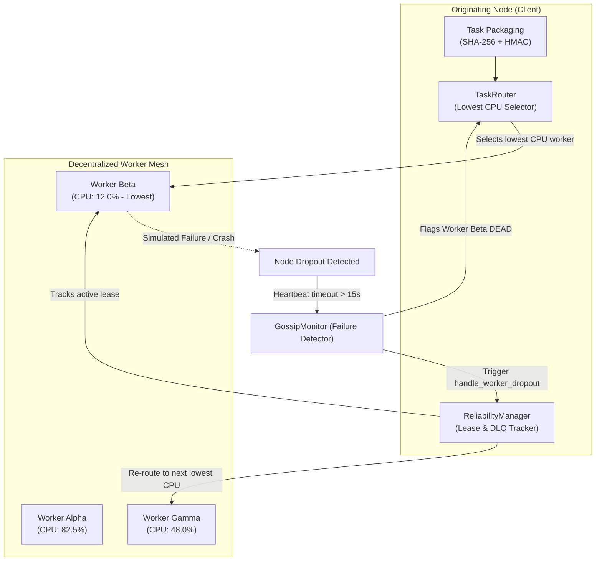
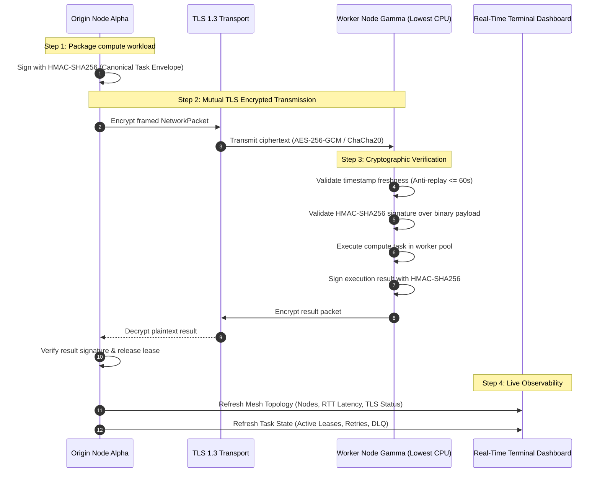

# MeshWeaver Weeks 3 & 4 Architectural Specification

## 1. Executive Summary

This document specifies the architecture, algorithms, wire protocols, and operational workflows delivered for **Week 3** (Task Routing & Fault Tolerance) and **Week 4** (TLS/SSL Security, Cryptographic Signatures, and Real-Time Topology & Task State Dashboard) of the **MeshWeaver Decentralized P2P Task Broker**.

MeshWeaver completely eliminates centralized message queues (e.g., Redis, RabbitMQ, Celery) by enabling nodes to self-organize into an asynchronous peer-to-peer compute mesh with hardware-load-aware routing, automated fault recovery, and end-to-end cryptographic integrity.

---

## 2. Week 3 Architecture: Task Routing & Fault Tolerance

### 2.1 Task Routing Algorithm (Lowest CPU Load)
* **Mathematical Selection Policy**:
  $$\text{Target Worker} = \arg\min_{w \in \mathcal{W}_{\text{healthy}} \setminus \mathcal{E}} \left( \text{CPU}_w, \text{Tasks}_w \right)$$
  where $\mathcal{W}_{\text{healthy}}$ represents candidate nodes whose elapsed heartbeat $\le 15.0\text{s}$, and $\mathcal{E}$ represents the exclusion set of nodes that have previously failed during the task's execution lifecycle.
* **Composite Load Scoring**:
  $$\text{Composite Score} = (0.6 \times \text{CPU\%}) + (0.3 \times \min(100.0, \text{Tasks} \times 10)) + (0.1 \times \text{RAM\%})$$
* **Exclusion Constraints**: During retry attempts, the failed worker ID is permanently added to the task assignment's `failed_node_ids` set to prevent re-routing back to an unstable peer.

### 2.2 Two-Tier Heartbeat Failure Detector
* **`HEALTHY`**: Node has transmitted heartbeat or telemetry within `suspect_timeout` ($7.5\text{s}$).
* **`SUSPECT`**: Elapsed time exceeds $7.5\text{s}$. Emits cluster warning; tolerates transient network delays.
* **`DEAD`**: Elapsed time exceeds `heartbeat_timeout` ($15.0\text{s}$). Node is flagged unresponsive; worker dropout event fires.

### 2.3 Automated Task Recovery & Dead-Letter Escalation
1. **Dropout Event Handling**:
   - `GossipMonitor` detects expired heartbeat $\to$ invokes `ReliabilityManager.handle_worker_dropout(dead_node_id, router)`.
   - All active in-flight task leases assigned to `dead_node_id` are extracted.
   - For each orphaned task, `task.retry_count` is incremented.
   - If `task.retry_count <= task.max_retries`: The task is immediately scheduled on the next healthiest peer with lowest CPU load.
   - If `task.retry_count > task.max_retries`: The task is moved to `dead_letter_tasks` (DLQ) with a diagnostic autopsy error reason.

---

## 3. Week 4 Architecture: TLS Security, Signatures & Dashboard

### 3.1 Transport Layer Security (TLS/SSL)
* **X.509 Node Certificates**: Automatically generates RSA 2048-bit self-signed certificates and private keys on startup (`security/tls.py`).
* **Protocol Hardening**: Explicitly disables SSLv2, SSLv3, TLS 1.0, and TLS 1.1, enforcing modern TLS 1.2+ / TLS 1.3 with high-grade cipher suites (`ECDHE-RSA-AES256-GCM-SHA384`, `ECDHE-RSA-CHACHA20-POLY1305`).
* **Zero-Dependency Development Mesh**: Client SSL context operates without central CA authorities by verifying transport encryption in peer-to-peer topologies.

### 3.2 Cryptographic Signatures (HMAC-SHA256)
* **Canonical Wire Representation**:
  $$\text{Canonical String} = \text{MESHWEAVER\_TASK\_V1}:\{\text{task\_id}\}:\{\text{name}\}:\{\text{payload\_sha256}\}:\{\text{signer\_node\_id}\}:\{\text{timestamp}\}$$
* **Tamper Prevention**: Any byte modification to the serialized function, arguments, task ID, or name causes instant signature mismatch and execution rejection (`SignatureVerificationError`).
* **Replay Attack Mitigation**: Requests with timestamps older than $60.0\text{s}$ or drifting into the future are rejected with `ReplayAttackError`.

### 3.3 Real-Time CLI Terminal Dashboard
* **Topology View**:
  - Displays all nodes, endpoints, TLS encryption badges (`🔒 TLS`), and inter-node RTT link latencies.
* **Live Task Execution State**:
  - Displays in-flight active leases with work unit name, origin node, assigned worker, runtime, retry attempt counters, and cryptographic verification badges (`🔒 Signed`).
  - Dedicated **Dead-Letter Queue (DLQ)** panel displaying permanently failed tasks and root causes.
* **Hardware Meters**: Visual progress bars (`[████░░░░░░]`) for CPU and RAM utilization.
* **Compatibility**: Native Rich layout rendering when `rich` is installed, falling back cleanly to ANSI/Unicode double-line box frames on bare edge environments.

---

## 4. Verification & Testing Matrix

| Week | Project Requirement | Implementation File | Verification Test |
|---|---|---|---|
| **Week 3** | Lowest CPU task routing algorithm | `scheduler/router.py` | `test_routing_selects_lowest_cpu_node` |
| **Week 3** | Dynamic load-aware route updating | `scheduler/router.py` | `test_routing_dynamic_load_update` |
| **Week 3** | Failure exclusion during retries | `scheduler/router.py` | `test_routing_excludes_failed_worker` |
| **Week 3** | Continuous heartbeat failure detector | `gossip/monitor.py` | `test_worker_dropout_detection` |
| **Week 3** | Automatic task re-routing on crash | `scheduler/reliability.py` | `test_automatic_task_rerouting_on_worker_dropout` |
| **Week 3** | Bounded retries & Dead-Letter Queue | `scheduler/reliability.py` | `test_retry_exhaustion_moves_task_to_dead_letter_queue` |
| **Week 4** | TLS/SSL node communication wrapping | `security/tls.py` | `test_in_memory_tls_handshake_and_encryption` |
| **Week 4** | X.509 certificate & key generation | `security/tls.py` | `test_x509_certificate_generation` |
| **Week 4** | HMAC-SHA256 task request signatures | `security/crypto.py` | `test_sign_and_verify_valid_task` |
| **Week 4** | Malicious payload tamper rejection | `security/crypto.py` | `test_tamper_detection_on_payload` |
| **Week 4** | Anti-replay timestamp validation | `security/crypto.py` | `test_replay_attack_rejection` |
| **Week 4** | Real-time mesh topology visualization | `dashboard/cli.py` | `test_dashboard_renders_mesh_topology` |
| **Week 4** | Live task execution & DLQ dashboard | `dashboard/cli.py` | `test_dashboard_renders_task_execution_state` |
