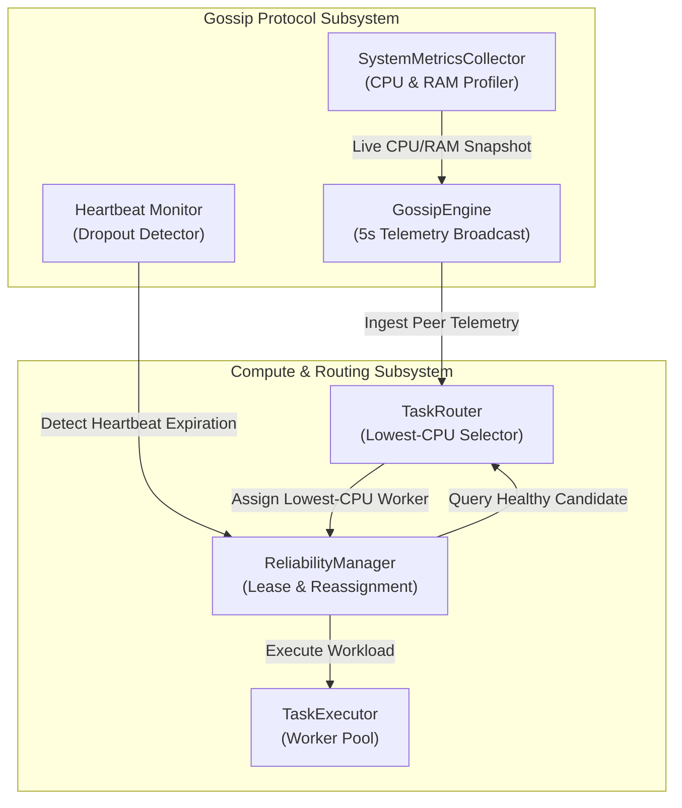

# MeshWeaver Workload Routing & Fault Tolerance Subsystem

## 1. Executive Summary

This document details the decentralized task scheduling and robust fault tolerance architecture:
1. **Load-Aware Task Routing**: Dynamically routing submitted tasks to the worker node reporting the lowest CPU load across the mesh.
2. **Gossip Protocol Engine**: Background asynchronous dissemination of CPU/RAM resource metrics and active workloads every 5 seconds.
3. **Heartbeat Failure Detection**: Tracking peer heartbeat freshness and detecting unannounced worker crashes within a configurable timeout window (15.0s default).
4. **Instant Task Re-Routing**: Capturing orphaned in-flight tasks upon worker dropout and seamlessly reassigning them to alternative healthy peers.
5. **Bounded Retries & Dead-Letter Isolation**: Preventing cascading retry storms by bounding retry attempts and moving permanently failing tasks to a dead-letter queue.

---

## 2. Component Architecture



---

## 3. Detailed Specifications

### 3.1 Task Routing Algorithm (`scheduler/router.py`)
- **Strategy `LOWEST_CPU`**:
  ```python
  chosen = min(healthy_candidates, key=lambda w: (w.cpu_percent, w.active_tasks))
  ```
- **Composite Load Index**:
  $$\text{Score} = (0.6 \times \text{CPU\%}) + (0.3 \times \text{Active Task Pressure}) + (0.1 \times \text{RAM\%})$$
- **Failure Exclusion**:
  When a task is retried after a node failure, the failed node is added to `exclude_node_ids` so the task is guaranteed not to cycle back to the same failing worker.

### 3.2 Gossip Protocol & Heartbeat Monitors (`gossip/engine.py`)
- **Broadcast Loop**: Every 5.0 seconds, nodes capture their local CPU/RAM metrics and send gossip datagrams to a random fanout ($\text{fanout}=3$) of peers.
- **Heartbeat Monitor**: Sweeps peer registries every 2.0 seconds:
  ```python
  if time.time() - peer.last_heartbeat > heartbeat_timeout:
      peer.is_alive = False
      router.mark_worker_dead(peer.node_id)
      reliability.handle_worker_dropout(peer.node_id, router)
  ```

### 3.3 Dynamic Reassignment (`scheduler/reliability.py`)
- Each task execution receives an active lease.
- When `handle_worker_dropout(dead_node_id, router)` is invoked:
  1. Finds all in-flight tasks leased to `dead_node_id`.
  2. Increments `task.retry_count`.
  3. Queries `TaskRouter` for the next available healthy worker with the lowest CPU load (excluding the dead node).
  4. Dispatches the orphaned task to the new worker.

---

## 4. Verification

Run the dedicated Week 3 interactive verification demo:
```bash
python examples/week3_task_routing_and_recovery_demo.py
```
Run automated unit tests:
```bash
python -m unittest tests/test_scheduler.py tests/test_gossip.py
```
