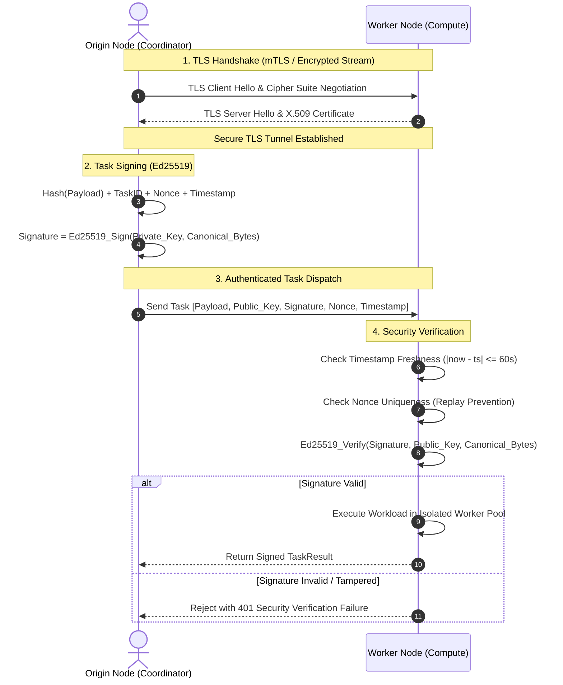

# MeshWeaver Security & Real-Time Monitoring Subsystem

## 1. Executive Summary

This document details the cryptographic security, transport encryption, and observability architecture:
1. **Transport Layer Security (TLS/SSL)**: Wrapping all node-to-node TCP communication in modern TLS 1.2+ encrypted tunnels with automated self-signed X.509 certificate provisioning.
2. **Cryptographic Signatures (Ed25519)**: Enforcing asymmetric digital signatures on every task execution request to ensure origin authenticity, tamper detection, and authorization.
3. **Replay & Tamper Defense**: Canonical payload hashing combined with timestamp freshness bounds ($\pm 60$s) and single-use nonce tracking to defeat replay and tampering attacks.
4. **Rich Terminal Dashboard**: Hacker-style real-time CLI dashboard displaying cluster topology, DHT routing tables, gossip telemetry, and live execution pipelines.
5. **Edge Deployment Packaging**: Standardized `pyproject.toml` configuration enabling deployment as a standalone CLI package (`meshweaver`).

---

## 2. Security Subsystem Architecture



---

## 3. Cryptographic Signature Wire Format

The canonical message for signature generation and verification:
```
MESHWEAVER:TASK:{task_id}:{origin_node_id}:{sha256(payload)}:{timestamp:.4f}:{nonce}
```
Fields:
- `task_id`: Unique UUID of the compute task.
- `origin_node_id`: Node ID of the submitting peer.
- `sha256(payload)`: Hexadecimal digest of the binary serialized callable.
- `timestamp`: Unix timestamp enforcing a 60-second validity window.
- `nonce`: Random UUID cached by the receiving node to reject replays.

---

## 4. Live CLI Dashboard (`dashboard/cli.py`)

Built with the `rich` library, the dashboard provides a high-density, multi-panel terminal interface:
- **Header**: Local Node ID, TCP/TLS endpoint, UDP DHT endpoint, security and cipher status.
- **Kademlia DHT Panel**: Discovered neighbors, XOR distance metric, RTT latencies, and last seen timestamps.
- **Gossip Telemetry Panel**: Peer CPU% with color thresholds (green < 40%, yellow < 75%, red $\geq$ 75%), RAM%, active tasks, and health status (`ONLINE`, `LAGGING`, `DEAD`).
- **Task Engine Panel**: In-flight leases, completed counts, retried tasks, dead-letter count, average runtime, and recent task table.
- **Live Event Log**: Real-time scrolling audit log of topology and scheduling events.

---

## 5. Verification

Run the dedicated Week 4 interactive verification demo:
```bash
python examples/week4_security_and_dashboard_demo.py
```
Run automated unit tests:
```bash
python -m unittest tests/test_security.py tests/test_mesh_node.py
```
